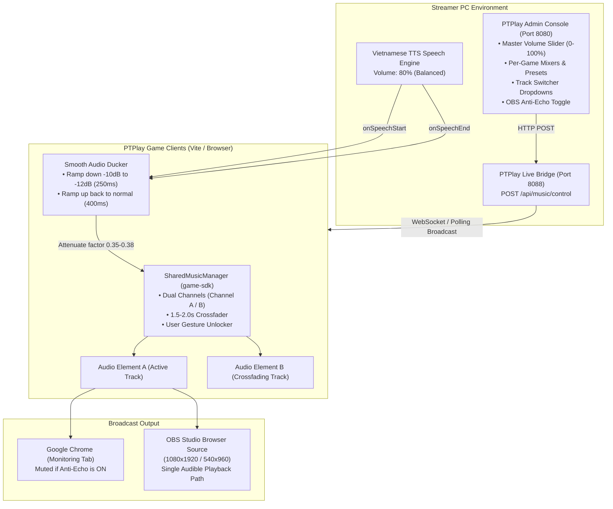

# PTPlay Shared Music & Livestream Audio Architecture Guide

## 1. Overview & Signal Flow Architecture

PTPlay incorporates a centralized **Shared Music Manager** across all 5 live interactive games (`cat-cafe`, `mini-war-arena`, `english-class-live`, `quiz-show`, and `duoi-hinh-bat-chu`). The audio pipeline provides seamless looping, crossfading, automatic speech ducking, anti-echo protection, and live mixer control from the PTPlay Admin console.

---

## 2. Audio Ducking & TTS Speech Balance

### Speech Balance Problem
Standard browser Web Speech API outputs utterances at full volume (`1.0`), which frequently distorts or drowns out background music. If the background music is completely stopped or muted, the livestream suffers from awkward "dead silence" holes whenever the speaker pauses.

### PTPlay Solution
1. **TTS Volume Lock:** Vietnamese host/teacher TTS utterance volume is calibrated to **`0.80` (80%)** by default in [`tts.ts`](file:///c:/Workspace/PTPlay/packages/game-sdk/src/tts.ts#L40) and the Admin TTS Studio slider.
2. **Smooth Ducking Ramp:** When speech begins, [`SharedMusicManager.duckAudio()`](file:///c:/Workspace/PTPlay/packages/game-sdk/src/music/SharedMusicManager.ts#L180) attenuates background music by a factor of `0.35`–`0.38` (-10 to -12 dB) over **250ms**.
3. **Smooth Restoration:** When speech finishes (or on timeout/error fallback), [`SharedMusicManager.restoreAudio()`](file:///c:/Workspace/PTPlay/packages/game-sdk/src/music/SharedMusicManager.ts#L200) ramps BGM back to 100% of the user-configured level over **400ms**.
4. **Audibility Guarantee:** The background music **remains softly and clearly audible** during speech, providing a professional broadcast atmosphere.

---

## 3. The 15 Curated CC0 Tracks Catalog

All 15 tracks were sourced from OpenGameArt under verified **Creative Commons Zero (CC0 - Public Domain / Free for Commercial Broadcast)** licenses and are physically mirrored in `shared-music/` and each game's `public/shared-music/`:

| Game | Cue / Role | Track Title | Author | Format | BPM | OpenGameArt Source Page |
|---|---|---|---|---|---|---|
| **Café Mòe** | `gameplay` (Main) | Cat caffe | TAD | MP3 | 80 | [lofi-compilation](https://opengameart.org/content/lofi-compilation) |
| **Café Mòe** | `gameplay` (Alt) | A cup of tea | TAD | MP3 | 75 | [lofi-compilation](https://opengameart.org/content/lofi-compilation) |
| **Café Mòe** | `nap` (Sleep) | Chill lofi inspired | qubodup | OGG | – | [chill-lofi-inspired-loop-edit](https://opengameart.org/content/chill-lofi-inspired-loop-edit) |
| **Mini War Arena** | `battle` | Heartfelt Battle | request | OGG | – | [heartfelt-battle](https://opengameart.org/content/heartfelt-battle-loopable-fantasy-stringspianohorn) |
| **Mini War Arena** | `boss` | Epic Boss Battle | SubspaceAudio | WAV | – | [boss-battle-music](https://opengameart.org/content/boss-battle-music) |
| **Mini War Arena** | `final_boss` | Boss Battle Theme | Cleyton Kauffman | OGG | – | [boss-battle-theme](https://opengameart.org/content/boss-battle-theme) |
| **English Class LIVE** | `lobby` | Cozy Puzzle Stage Select | MintoDog | OGG | 100 | [cozy-puzzle-stage-select](https://opengameart.org/content/cozy-puzzle-stage-select) |
| **English Class LIVE** | `question` | Cozy Puzzle In-Game 1 | MintoDog | OGG | 118 | [cozy-puzzle-in-game-1](https://opengameart.org/content/cozy-puzzle-in-game-1) |
| **English Class LIVE** | `celebration` | Party and Gameover Loop | gilzoide | OGG | – | [party-and-gameover-loop](https://opengameart.org/content/party-and-gameover-loop) |
| **Đố Vui Có Thưởng** | `celebration` | Funky Disco Beats | Fupi | OGG | – | [funky-disco-beats](https://opengameart.org/content/funky-disco-beats-to-boogiewoogie-to) |
| **Đố Vui Có Thưởng** | `question` | Funked Up | Joth | MP3 | – | [funked-up](https://opengameart.org/content/funked-up) |
| **Đố Vui Có Thưởng** | `lobby` | Catchy Swing | Doge | OGG | – | [catchy-swing](https://opengameart.org/content/catchy-swing) |
| **Đuổi Hình Bắt Chữ** | `lobby` | Magic Puzzle In-Game 1 | MintoDog | OGG | 110 | [magic-puzzle-in-game-1](https://opengameart.org/content/magic-puzzle-in-game-1) |
| **Đuổi Hình Bắt Chữ** | `thinking` | Cozy Puzzle In-Game 3 | MintoDog | OGG | 108 | [cozy-puzzle-in-game-3](https://opengameart.org/content/cozy-puzzle-in-game-3) |
| **Đuổi Hình Bắt Chữ** | `transition` | Music Loops (four_loop) | pauliuw | MP3 | – | [music-loops](https://opengameart.org/content/music-loops) |

---

## 4. OBS Studio vs Chrome Echo Protection

### The Problem
Streamers usually open Google Chrome to monitor the game UI while simultaneously adding an OBS **Browser Source** (1080x1920 or 540x960) to broadcast the stream. Without coordination, both Chrome and OBS render audio, generating an unbearable double-echo on the stream.

### The Solution
1. **OBS Detection:** In OBS Studio Browser Source, the global JavaScript variable `window.obsstudio` is defined.
2. **Anti-Echo Setting:** In Admin Console, checking **"Chỉ phát âm thanh trong OBS (Mute Chrome Preview)"** stores `ptplay_obs_only_audio = true` in `localStorage`.
3. **Single Audible Path:** [`SharedMusicManager.isAudiblePlaybackAllowed()`](file:///c:/Workspace/PTPlay/packages/game-sdk/src/music/SharedMusicManager.ts#L65) detects if execution is occurring inside Chrome preview when protection is active, setting `<audio>` volume to 0 on Chrome while allowing OBS Studio Browser Source to output pure, un-echoed game audio.

---

## 5. Live Mixer & Music Switcher in Admin

Located in tab **🎵 Thư Viện Nhạc (CC0 BGM)** ([`index.html`](file:///c:/Workspace/PTPlay/apps/admin/public/index.html#L2305)):

1. **Master BGM Bar:**
   * Global volume slider (0% to 100%)
   * Quick `[-]` and `[+]` 5% adjustment buttons
   * Quick Live Presets: 20% (talking), 35% (standard live), 50% (energetic), 70% (boss climax)
   * Global Mute / Unmute
2. **5-Game Live Mixer Cards:**
   * Dedicated volume sliders and +/- 5% buttons per game
   * Dedicated mute buttons
   * Music Switcher `<select>` with cues and individual tracks
   * `🔀 Đổi Nhạc` button sending live command via `POST /api/music/control`
3. **CC0 Soundboard Player:**
   * Allows host to preview any of the 15 tracks directly in Admin with real-time ducking simulation.
